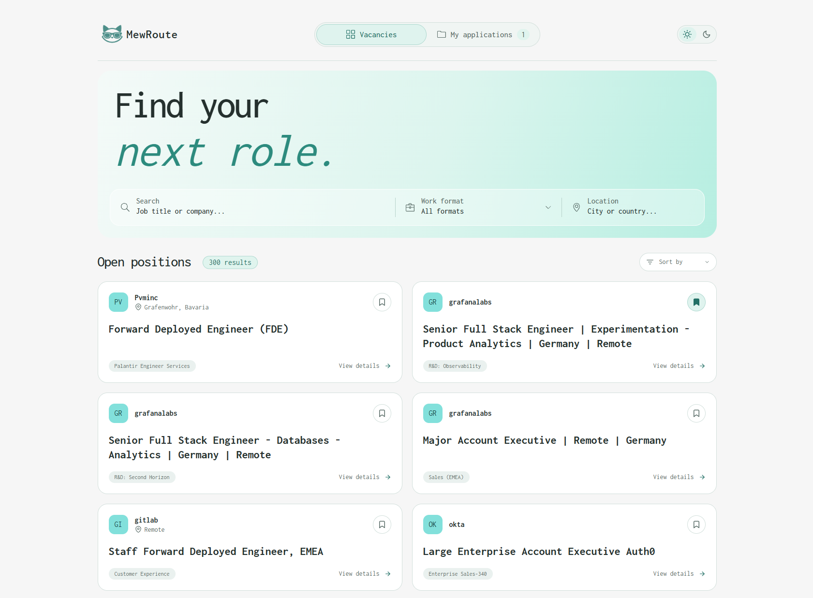
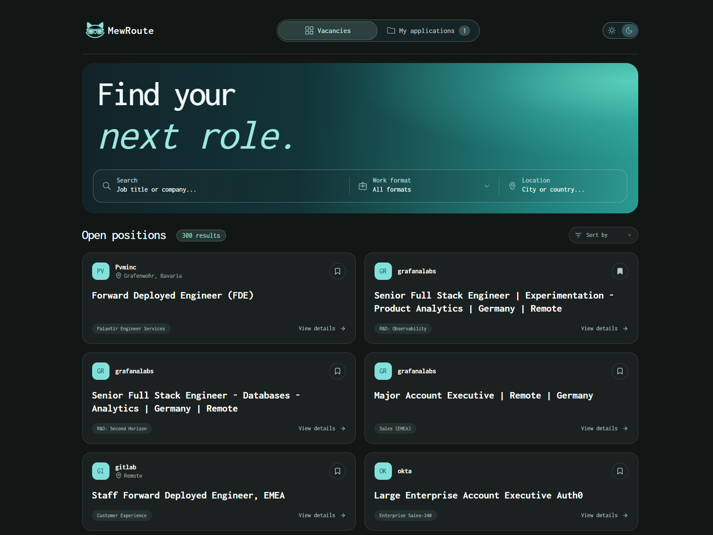

# MewRoute

A React application for searching, exploring, and saving job opportunities in Germany.

MewRoute is an independently developed portfolio project covering frontend development, integration with the external Arbeitnow API, client-side routing, state management, and browser-based data persistence.

## Features

- Search for jobs by position title or company name.
- Filter job listings by location and work arrangement.
- Sort vacancies by date (newest or oldest first).
- Navigate through job listings using pagination.
- Save jobs to favorites, remove individual entries, or clear the entire list.
- View detailed job information and visit the original job posting to apply.
- Switch between light and dark themes with persistent preferences.
- Responsive design for different screen sizes.
- Loading states, API error handling, and fallback pages for unknown routes.
- Partial unit test coverage of core functionality.

## Tech Stack

- **React** - Component-based UI development, state management, and custom hooks.
- **React Router** - Client-side navigation and routing.
- **JavaScript** - Data processing, searching, filtering, and sorting.
- **CSS** - Styling, responsive layouts, and theme implementation.
- **Fetch API & AbortController** - Asynchronous data fetching and request cancellation.
- **localStorage** - Persistent storage for saved jobs and theme preferences.
- **Vite** - Development server and production build tooling.
- **Vitest** - Unit testing.
- **React Icons** - Interface icons.

## Getting Started

**Recommended environment:** Node.js 24.x and npm.

Clone the repository:

```bash
git clone https://github.com/FinrichEu/MewRoute.git
```

Navigate to the project directory:

```bash
cd MewRoute
```

Install dependencies:

```bash
npm ci
```

Start the development server:

```bash
npm run dev
```

Open the local URL displayed in your terminal.

## Available Scripts

| Command | Description |
| --- | --- |
| `npm run dev` | Start the development server |
| `npm run build` | Create a production build in the `dist` directory |
| `npm run preview` | Preview the production build locally |
| `npm run lint` | Run the configured code linter |
| `npx vitest run` | Run unit tests once |

Run `npm run build` before using `npm run preview`.

## Project Structure

```text
src/
├── API/             # Job API requests
├── assets/          # Images and static assets
├── components/      # Job cards, filters, navigation, and UI
├── hooks/           # Custom hooks for jobs and favorites
├── pages/           # Application pages
├── utils/           # Search, filtering, sorting, and tests
├── App.jsx          # Application structure and routing
├── main.jsx         # Application entry point
└── index.css        # Global styles
```

## Data Management

Job listings are fetched from the public [Arbeitnow API](https://www.arbeitnow.com/api/job-board-api).

Searching, filtering, and sorting are performed on the client side using the fetched data.

The application currently retrieves the first page of the API response. Client-side pagination divides these results into pages of 20 jobs each.

Saved jobs are stored as complete objects in `localStorage`. This allows users to access their saved listings after refreshing the page, even if those jobs are no longer present in the currently fetched results.

If `localStorage` is unavailable or blocked by the browser, favorites remain accessible in memory until the page is reloaded.

## Testing

Unit tests are implemented using **Vitest**.

The current test suite for the `selectJobs` function covers:

- Searching for jobs by position title.
- Returning an empty result when no jobs match the search query.
- Sorting jobs by date, from oldest to newest.

Test coverage is currently limited, with plans to expand it to additional filtering, sorting, and application scenarios.

## Current Limitations

- Saved jobs are stored locally in the user's browser and are not synchronized across devices.
- Saved job listings represent snapshots of their data at the time they were saved. Their current availability should be verified through the original job posting.
- Search and filtering operate only on the currently fetched API data, not the entire Arbeitnow database.
- The application interface is available in English.

## Screenshots




## Live Website

Link

## Author

**FinrichEu**

GitHub: [github.com/FinrichEu](https://github.com/FinrichEu)

This project was independently developed for learning, practical experience, and demonstrating frontend development skills.
